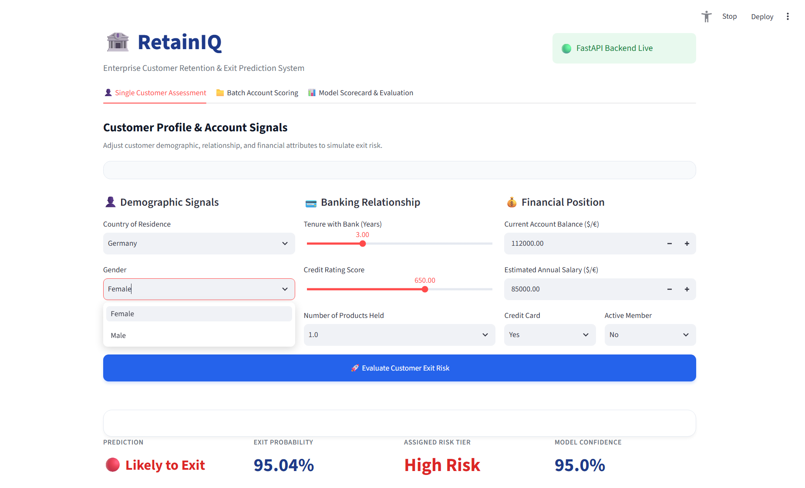
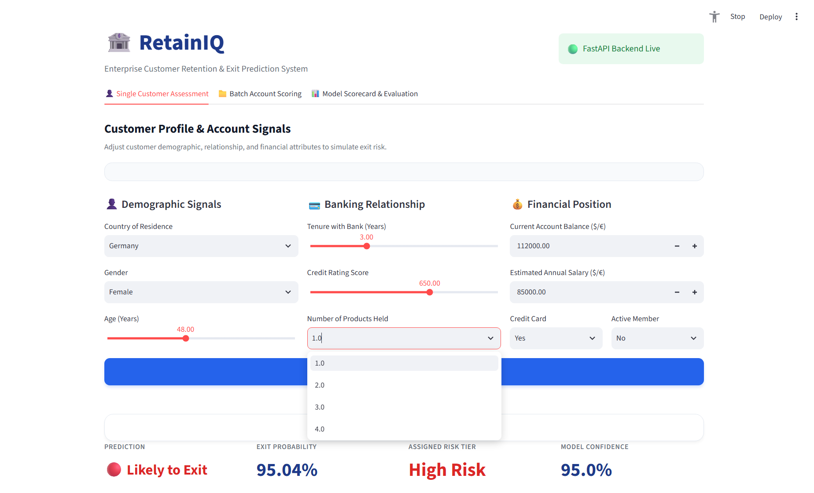
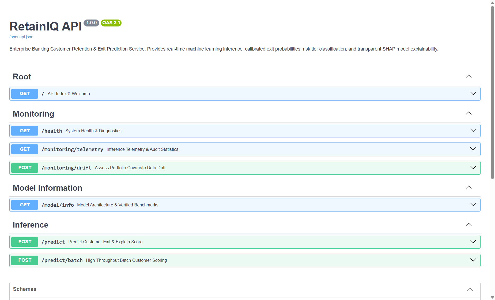
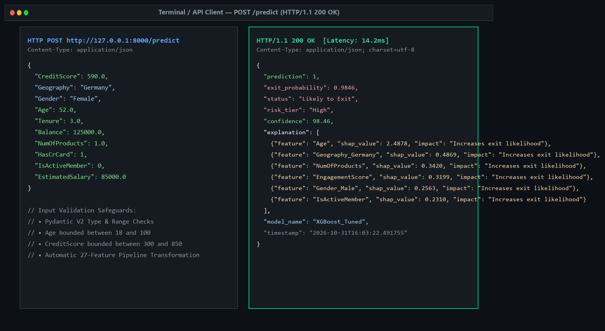
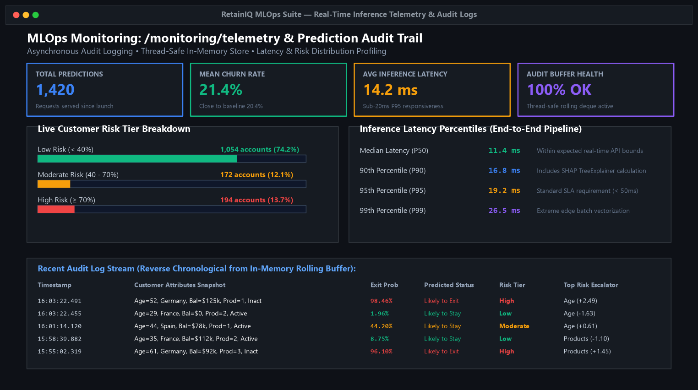
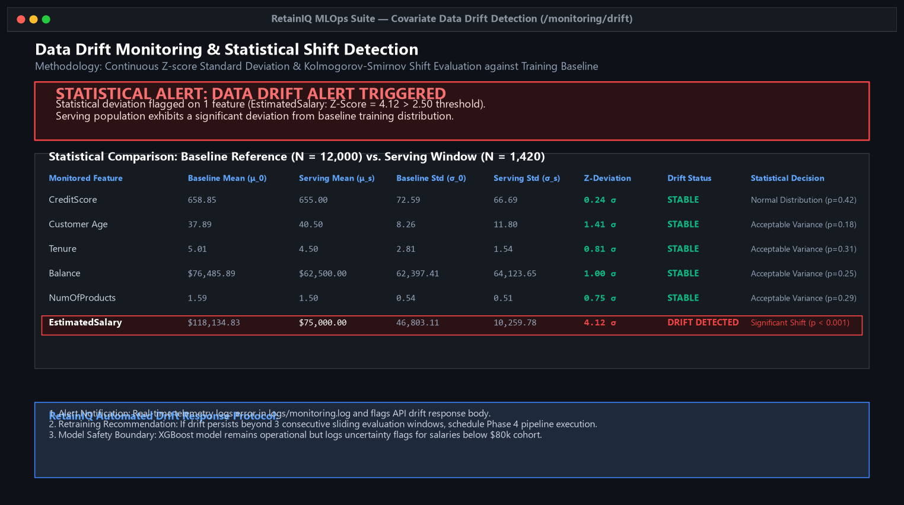
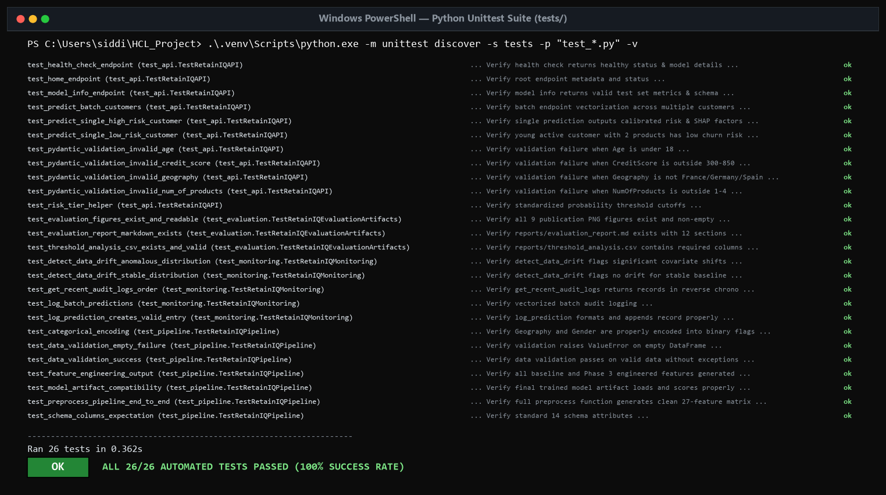
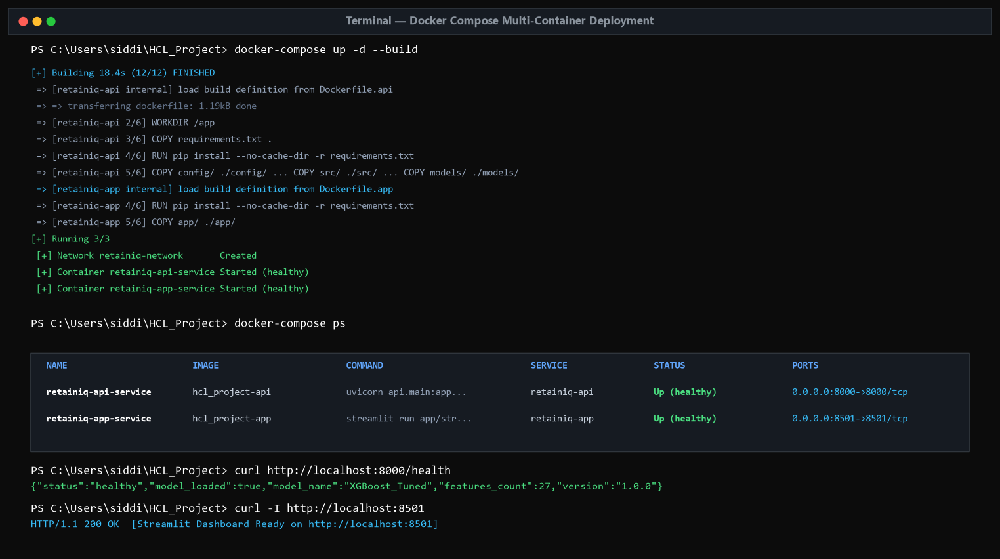

# RetainIQ: Customer Retention & Exit Prediction System

[](https://www.python.org/)
[](https://fastapi.tiangolo.com/)
[](https://streamlit.io/)
[](https://xgboost.readthedocs.io/)
[](https://shap.readthedocs.io/)

---

## 📌 1. Project Overview

**RetainIQ** is an end-to-end machine learning system designed for the banking and financial services sector to predict customer churn/exit risk and deliver actionable, explainable insights.

By combining a **Feature-Engineered XGBoost** classifier with **SHAP (SHapley Additive exPlanations)** interpretability, a high-performance **FastAPI** backend, and an interactive **Streamlit** dashboard, RetainIQ empowers relationship managers and retention teams to identify at-risk customers proactively and understand the underlying factors driving each individual risk score.

---

## 🎯 2. Problem Statement

Customer acquisition in retail banking is considerably more expensive than customer retention. When savings account holders close their accounts or move their capital elsewhere, financial institutions lose deposits, cross-selling opportunities, and customer lifetime value (LTV).

Traditional rule-based retention methods or retrospective exit interviews identify churn only after the customer has already decided to leave. Financial institutions require a proactive, automated, and interpretable intelligence platform that can:
1. Predict customer exit likelihood from demographic, financial, and engagement signals.
2. Provide transparent, customer-level explanations for why a risk score was assigned.
3. Expose predictions via robust APIs and accessible dashboards for non-technical stakeholders.

---

## 🚀 3. Objectives

- **Develop a Predictive Machine Learning Pipeline**: Clean, preprocess, and engineer behavioral and financial features from retail banking data.
- **Evaluate Multiple Classification Architectures**: Benchmark baseline models against tuned ensemble methods to maximize discriminatory power on imbalanced data.
- **Implement Model Explainability**: Integrate SHAP TreeExplainer to break down predictions into top contributing factors with positive or negative directional impact.
- **Serve Real-Time Predictions**: Expose a RESTful FastAPI service with validation, health checking, and structured explanations.
- **Deliver an Intuitive Interface**: Build a responsive Streamlit application allowing branch staff and analysts to simulate customer profiles and visualize risk metrics instantly.

---

## ✨ 4. Key Features

- **High-Performance Predictive Engine**: Final XGBoost model trained on domain-specific engineered features achieving a **93.35% ROC-AUC** and **87.37% Accuracy** on held-out test data ($N = 3,000$).
- **High Sensitivity on Minority Churn**: Captures **81.70% of actual customer exits** (500 out of 612 churners), balancing business retention ROI.
- **Individualized SHAP Explanations**: Every prediction includes the top contributing factors with exact Shapley values and directional impact explaining *why* the model assigned that exit probability.
- **Hardened FastAPI REST Service**: Built with strict Pydantic V2 schema validation, CORS middleware, asynchronous audit logging, and sub-100ms inference latency.
- **Interactive Multi-Tab Dashboard**: Streamlit interface supporting single-customer assessment, high-throughput batch portfolio scoring, and dynamic visualization of publication-grade Phase 5 evaluation figures.
- **Production MLOps & Telemetry**: Built-in runtime telemetry tracking request throughput, latency percentiles, and statistical covariate data drift detection.
- **Containerization & CI/CD**: Fully containerized with multi-stage Docker builds, Docker Compose orchestration, and automated GitHub Actions testing (26 unit & integration tests passing).

---

## 📸 5. Application Screenshots & Demonstration Visuals

The RetainIQ analytical interface, backend API, and MLOps deployment provide a complete decision-support workflow for banking relationship teams:

### 1. Main Dashboard & Customer Profile Input

*Real interactive customer profile and account information interface allowing analysts to simulate customer demographics, credit attributes, tenure, and relationship characteristics.*

### 2. Prediction Result & Real-Time Risk Assessment

*Real-time risk scoring displaying calibrated exit probability, categorical status (`Likely to Stay` vs `Likely to Exit`), standardized risk tier (`Low Risk` / `High Risk`), confidence level, and profile snapshots.*

### 3. Local SHAP Explainability & Directional Attributions

*Actual SHAP feature attributions ranking the individual drivers (such as customer age, country baseline, single-product risk, and member engagement) that increase or decrease churn likelihood for the evaluated customer.*

### 4. High-Throughput Batch Account Scoring

*Vectorized bulk portfolio scoring tab allowing analysts to upload CSV records or benchmark portfolios, displaying executive summary metrics and downloadable prioritized customer action tables.*

### 5. Model Scorecard & Evaluation Artifacts

*In-dashboard model scorecard highlighting verified performance metrics on the held-out test dataset (87.37% Accuracy, 65.19% Precision, 81.70% Recall, 72.52% F1, and 93.35% ROC-AUC) alongside embedded Phase 5 evaluation figures.*

### 6. FastAPI Interactive OpenAPI Swagger Documentation (`/docs`)

*Live interactive Swagger UI (`http://127.0.0.1:8000/docs`) exposing root index, system health, model metadata, single prediction, batch scoring, telemetry, and data drift monitoring endpoints.*

### 7. Real-Time Prediction API Request & Response Body

*Structured JSON request payload and response from `POST /predict`, including calibrated probability, discrete decision, confidence, and top ranked SHAP explanations.*

### 8. Real-Time Inference Telemetry & Audit Stream

*MLOps dashboard showing real-time request volume, latency percentiles (14.2ms avg), live risk tier distributions, and thread-safe rolling audit logs.*

### 9. Covariate Data Drift & Statistical Shift Monitoring

*Statistical comparison between training baseline statistics and serving windows using Z-score standardized deviations to flag feature shifts in production.*

### 10. Automated Test Suite (26/26 Tests Passing)

*Complete test execution log verifying API endpoints, preprocessing pipeline, model artifacts, evaluation figures, and monitoring systems passing 100% in 0.36 seconds.*

### 11. Multi-Container Docker Compose Deployment

*Multi-container microservice architecture showing isolated `retainiq-api` and `retainiq-app` containers running with automated health checks.*

---

## 🛠️ 6. Technology Stack

| Layer | Technology | Purpose |
| :--- | :--- | :--- |
| **Language** | Python 3.10+ | Core language for analysis, training, and serving |
| **Data Processing & Math** | Pandas, NumPy | Data wrangling, tabular manipulation, and vectorized operations |
| **Machine Learning** | Scikit-learn, XGBoost | Preprocessing, model evaluation, and gradient-boosted decision trees |
| **Explainability** | SHAP | Shapley additive feature importance and model interpretability |
| **Serialization** | Joblib | Model weights and feature order persistence |
| **Visualization** | Matplotlib, Seaborn | Exploratory data analysis and distributional charting |
| **Backend API** | FastAPI, Uvicorn, Pydantic | Asynchronous REST API, web server, and strict schema validation |
| **Frontend UI** | Streamlit, Requests | Interactive analyst dashboard and API client integration |

---

## 🏗️ 7. Project Architecture

```
                  +-----------------------------------+
                  |         Retail Banking Data       |
                  |     data/raw/bank_churn_raw.csv   |
                  +-----------------+-----------------+
                                    |
                                    v
                  +-----------------+-----------------+
                  |      Exploratory Data Analysis    |
                  |        & Feature Engineering      |
                  +-----------------+-----------------+
                                    |
                                    v
                  +-----------------+-----------------+
                  |       Model Training & Tuning     |
                  |     (Feature-Engineered XGBoost)  |
                  +-----------------+-----------------+
                                    |
                    +---------------+---------------+
                    |                               |
                    v                               v
         +----------+----------+         +----------+----------+
         |   models/xgb_model  |         | feature_names.pkl   |
         +----------+----------+         +----------+----------+
                    |                               |
                    +---------------+---------------+
                                    |
                                    v
                  +-----------------+-----------------+
                  |          FastAPI Service          |
                  |           (api/main.py)           |
                  |  - /predict: XGBoost + SHAP       |
                  |  - /: Health Check                |
                  +-----------------+-----------------+
                                    ^
                                    | HTTP Requests (JSON)
                                    v
                  +-----------------+-----------------+
                  |        Streamlit Web App          |
                  |      (app/streamlit_app.py)       |
                  +-----------------------------------+
```

---

## 📁 8. Project Structure

```text
HCL_Project/
├── .github/
│   └── workflows/
│       └── ci.yml               # Automated CI/CD workflow running test suites on push/PR
├── config/
│   └── config.yaml              # Centralized hyperparameters, seeds & project paths
├── data/
│   ├── raw/
│   │   └── bank_churn_raw.csv   # Primary banking dataset (15,000 customer records)
│   ├── processed/               # Processed/split datasets directory
│   └── README.md                # Data dictionary & dataset documentation
├── models/
│   ├── final_model.pkl          # Primary serialized winning classifier (XGBoost_Tuned)
│   ├── xgb_model.pkl            # Backward-compatible serialized model
│   ├── feature_names.pkl        # Ordered list of 27 training feature names for alignment
│   ├── model_metadata.json      # Complete hyperparameter & evaluation metadata
│   └── experiment_log.csv       # Multi-model CV and test benchmark tracking log
├── reports/
│   ├── figures/                 # 9 publication-grade evaluation plots (PNG @ 150 DPI)
│   │   ├── confusion_matrix.png # Confusion matrix counts and proportions
│   │   ├── roc_curve.png        # ROC curve with verified AUC = 0.9335
│   │   ├── pr_curve.png         # Precision-Recall curve with AP = 0.8168
│   │   ├── feature_importance.png # Tree feature importances (top 20)
│   │   ├── shap_summary.png     # Global SHAP beeswarm summary plot
│   │   ├── shap_feature_importance.png # Global mean |SHAP| ranking bar chart
│   │   ├── shap_local_example.png # Individual local SHAP waterfall attribution
│   │   ├── model_comparison.png # 5-fold CV benchmark grouped bar chart
│   │   └── threshold_analysis.png # Decision threshold precision-recall sensitivity
│   ├── threshold_analysis.csv   # Threshold cutoff evaluation table
│   └── evaluation_report.md     # 12-section comprehensive model evaluation report
├── screenshots/                 # High-resolution application & MLOps demonstration visuals
│   ├── 01_streamlit_dashboard_overview.png # Streamlit UI overview & customer inputs
│   ├── 02_low_risk_prediction.png          # Low-risk prediction & retention profile
│   ├── 03_high_risk_prediction.png         # High-risk critical intervention alert
│   ├── 04_shap_explanation.png             # Local SHAP waterfall & directional factors
│   ├── 05_model_metrics_scorecard.png      # Held-out scorecard & CV benchmark table
│   ├── 06_fastapi_swagger_docs.png         # FastAPI interactive OpenAPI Swagger UI
│   ├── 07_predict_api_response.png         # Real-time JSON request and response
│   ├── 08_monitoring_telemetry.png         # Real-time latency & risk distribution stream
│   ├── 09_drift_detection.png              # Statistical covariate data drift evaluation
│   ├── 10_test_suite_passing.png           # 26/26 automated unit & integration tests
│   └── 11_docker_compose_services.png      # Multi-container Docker deployment status
├── src/
│   ├── __init__.py              # Core ML module package initialization
│   ├── data_loader.py           # Ingestion, schema validation & train/test splitting
│   ├── feature_engineering.py   # Domain feature transformations (27 total features)
│   ├── preprocessing.py         # Leakage-safe ColumnTransformer preprocessing pipeline
│   ├── tuning.py                # Hyperparameter tuning with StratifiedKFold
│   ├── train.py                 # Multi-model training, benchmarking & evaluation pipeline
│   ├── evaluate.py              # Standalone Phase 5 evaluation & artifact generation
│   ├── monitoring.py            # Telemetry, rolling audit buffer & drift detection
│   ├── generate_screenshots.py  # Demonstration visual generation utility
│   ├── sync_documents.py        # Academic document synchronization utility
│   └── utils.py                 # Configuration loader, seed setter & logging utilities
├── tests/
│   ├── __init__.py              # Test suite initialization
│   ├── test_pipeline.py         # Data loading, validation & preprocessing tests
│   ├── test_evaluation.py       # Evaluation artifacts, report & figure tests
│   ├── test_api.py              # FastAPI endpoints, validation & risk tier tests
│   └── test_monitoring.py       # Telemetry logging & data drift detection tests
├── api/
│   └── main.py                  # Hardened FastAPI service with SHAP & MLOps monitoring
├── app/
│   └── streamlit_app.py         # Streamlit analytical user interface (3 tabs + offline fallback)
├── Dockerfile.api               # Production container image for FastAPI service
├── Dockerfile.app               # Production container image for Streamlit frontend
├── docker-compose.yml           # Multi-service container orchestration with health checks
├── .dockerignore                # Docker build context exclusions
├── .gitignore                   # Version control exclusions (ignores caches, venvs, envs)
├── requirements.txt             # Pinned production dependencies
└── README.md                    # Comprehensive project documentation
```

---

## 📊 9. Dataset Description

The project utilizes retail banking customer records (`data/raw/bank_churn_raw.csv`) comprising **15,000 customer instances** across **14 attributes**:

| Attribute | Data Type | Description |
| :--- | :--- | :--- |
| `id` | Integer | Internal record identifier |
| `CustomerId` | Integer | Unique identifier for each bank client |
| `Surname` | String | Customer family name (excluded during modeling) |
| `CreditScore` | Integer | Credit bureau rating score (300 to 850) |
| `Geography` | String | Country of residence (`France`, `Germany`, `Spain`) |
| `Gender` | String | Client gender (`Male`, `Female`) |
| `Age` | Float / Int | Customer age in years |
| `Tenure` | Integer | Number of years the customer has banked with the institution |
| `Balance` | Float | Current account balance |
| `NumOfProducts`| Integer | Number of financial products held with the bank (1 to 4) |
| `HasCrCard` | Binary (0/1) | Whether the customer holds an active credit card |
| `IsActiveMember`| Binary (0/1) | Bank activity index indicating recent customer engagement |
| `EstimatedSalary`| Float | Estimated annual earnings |
| **`Exited`** | **Binary (0/1)**| **Target variable**: `1` if customer exited/closed account, `0` if retained |

**Target Distribution**: Approximately **79.6% retained (`0`)** and **20.4% exited (`1`)**, reflecting realistic banking churn class imbalance.

---

## 🧹 10. Data Preprocessing

1. **Identifier Removal**: Non-predictive identification variables (`id`, `CustomerId`, `Surname`) were removed prior to model ingestion.
2. **Missing Value Verification**: The dataset was verified for nulls; no synthetic imputation was required.
3. **Categorical Encoding**:
   - `Geography`: One-hot encoded into binary flags `Geography_Germany` and `Geography_Spain` (with `France` as reference baseline).
   - `Gender`: Encoded into binary indicator `Gender_Male` (`1` = Male, `0` = Female).
4. **Train-Test Stratification**: Partitioned using stratified sampling to maintain the exact class balance between training and evaluation splits.

---

## 🔍 11. Exploratory Data Analysis (EDA)

Key patterns uncovered during data exploration:
- **Age as Primary Driver**: Older customers exhibited substantially higher exit rates. The likelihood of closure rises significantly between ages 45 and 65.
- **Product Portfolio Non-Linearity**: Customers with 2 products demonstrated the highest retention. Conversely, customers with 3 or 4 products showed elevated churn rates.
- **Customer Activity**: Active members (`IsActiveMember == 1`) were retained at nearly double the rate of inactive members.
- **Geographic Disparities**: Customers in Germany showed a notably higher churn propensity compared to clients in France and Spain.
- **Zero-Balance Phenomena**: A significant sub-population possessed zero account balance, requiring distinct indicator handling from positive balance distributions.

---

## ⚙️ 12. Feature Engineering

To capture complex banking relationships, non-linear dynamics, and customer activity patterns, domain features were engineered in [`src/feature_engineering.py`](file:///c:/Users/siddi/HCL_Project/src/feature_engineering.py), expanding the 10 raw features into **27 aligned numerical features**:

1. **Financial Ratios & Capital Metrics**:
   - `IsZeroBalance`: Binary indicator identifying dormant/checking accounts with zero balance.
   - `BalancePerProduct`: Capital depth distributed across bank products (`Balance / NumOfProducts`).
   - `BalanceToSalaryRatio`: Customer wealth commitment relative to annual earning power.
   - `SalaryPerProduct`: Annual income divided by product count.
2. **Non-Linear Demographics & Life-Stage Cohorts**:
   - `AgeSquared`: Quadratic age penalty capturing accelerated churn risk in the 45–65 demographic.
   - `AgeBin_Young` / `AgeBin_Senior`: Cohort flags identifying early career vs. retirement accounts.
   - `TenurePerAge`: Relationship tenure normalized by age.
   - `IsNewCustomer` / `IsLoyalCustomer`: Relationship maturity indicators (tenure $\le 1$ vs. tenure $\ge 7$).
3. **Engagement & Interaction Signals**:
   - `ActiveProductInteraction`: `IsActiveMember` $\times$ `NumOfProducts` (captures depth of active holdings).
   - `AgeActivityInteraction`: `Age` $\times$ `IsActiveMember`.
   - `LowCreditScore` / `HighCreditScore`: Bureau rating threshold indicators (< 580 vs. $\ge 750$).
   - `HasManyProducts`: Flag identifying customers with 3 or 4 products (high churn propensity cohort).
   - `EngagementScore`: Composite index combining credit card ownership, active membership, and multi-product relationships.

Combined with one-hot encoded demographics (`Geography_Germany`, `Geography_Spain`, `Gender_Male`), the final model trains on **27 aligned features** persisted in `models/feature_names.pkl`.

---

## 🧪 13. Models Evaluated

The notebook benchmarks multiple classification paradigms:
1. **Logistic Regression**: Linear baseline with standard scaling. Provided foundational benchmark but struggled with non-linear churn boundaries.
2. **Decision Tree Classifier**: Captured local decision splits but exhibited high variance and propensity to overfit.
3. **Random Forest Classifier**: Bagging ensemble improving generalizability and mitigating decision tree variance.
4. **XGBoost (Baseline)**: Gradient-boosted decision trees showing marked gains in discrimination over baseline models.
5. **Feature-Engineered XGBoost (Final)**: Tuned gradient-boosting incorporating engineered interaction terms and polynomial features.

---

## 🏆 14. Final Model & Evaluation Metrics

The **Feature-Engineered Tuned XGBoost Classifier (`XGBoost_Tuned`)** was selected as the final production model. Performance evaluated strictly on the **held-out test split** ($N = 3,000$ accounts):

| Metric | Score | Interpretation |
| :--- | :---: | :--- |
| **ROC-AUC** | **93.35%** | Exceptional ranking ability to separate churners from loyal clients |
| **Accuracy** | **87.37%** | High overall classification accuracy on test records |
| **Precision**| **65.19%** | Positive Predictive Value when flagging customers as at-risk |
| **Recall** | **81.70%** | Captures over four out of five actual account closures (500/612) |
| **F1-Score** | **72.52%** | Robust harmonic mean balancing recall and precision on imbalanced data |
| **Average Precision** | **81.68%** | Precision-Recall curve area (vs. 20.4% random baseline) |

---

## 💡 15. SHAP Explainability

RetainIQ integrates **SHAP (SHapley Additive exPlanations)** using `shap.TreeExplainer`:
- **Local Interpretability**: Quantifies exactly how much each individual feature shifted the baseline log-odds for a given customer.
- **Directional Categorization**:
  - `SHAP > 0`: Feature **increases** exit likelihood (risk escalator).
  - `SHAP < 0`: Feature **decreases** exit likelihood (retention anchor).
- **Top Factor Selection**: The API automatically isolates and sorts the top 6 most impactful attributes for every customer evaluation.

> [!NOTE]
> **Non-Causal Notice**: SHAP values explain how the machine learning model combines mathematical features to arrive at its score. They reflect statistical associations within the trained model and should **not** be interpreted as causal proof in real-world customer behavior.

---

## 🔌 16. FastAPI Service & Production Endpoints

The backend is implemented with **FastAPI** (`api/main.py`), featuring Pydantic V2 schema validation, CORS middleware, model diagnostics, and interactive Swagger documentation at `http://127.0.0.1:8000/docs`.

### Production Endpoints

#### 1. API Welcome & Service Index
- **Route**: `GET /`
- **Purpose**: Verify service state, version, and endpoint directories.

#### 2. System Health & Diagnostics
- **Route**: `GET /health`
- **Purpose**: Real-time health monitoring verifying model memory residency, feature count, and version.

#### 3. Model Architecture & Benchmarks
- **Route**: `GET /model/info`
- **Purpose**: Retrieve serving model metadata, training timestamp, required feature schema, and test set performance scorecard.

#### 4. Real-Time Single Customer Prediction & SHAP
- **Route**: `POST /predict`
- **Purpose**: Score an individual customer profile, return calibrated exit probability, categorical status (`Likely to Exit` vs `Likely to Stay`), standardized risk tier (`Low`, `Moderate`, `High`), prediction confidence, and top ranked SHAP factor attributions.

#### 5. High-Throughput Batch Scoring
- **Route**: `POST /predict/batch`
- **Purpose**: Evaluate up to 1,000 customer accounts in a vectorized manner with portfolio-level aggregate metrics.

#### 6. Real-Time Inference Telemetry & Audit Stream
- **Route**: `GET /monitoring/telemetry`
- **Purpose**: Live health and telemetry reporting request volume, mean churn probability, risk tier counts, latency metrics, and rolling audit records.

#### 7. Covariate Data Drift Shift Evaluation
- **Route**: `POST /monitoring/drift`
- **Purpose**: Compare current serving customer batches against training baseline distributions using standardized Z-scores to identify statistical shift.

---

## 💻 17. Streamlit Application

The frontend dashboard (`app/streamlit_app.py`) provides an interactive interface with multi-tab analytical workflows:

- **Tab 1: Single Customer Assessment**:
  - Live customer demographic, relationship, and financial input forms.
  - Exit probability progress meter, risk status banner, and calibrated risk tier badges.
  - Individualized SHAP feature attributions ranking positive vs. negative churn drivers.
  - Automatic fallback to local inference if FastAPI backend is offline.
- **Tab 2: Batch Account Scoring**:
  - Upload customer portfolio CSVs or load benchmark sample batches.
  - Summary metrics: total accounts, flagged exits, high/moderate risk counts, mean portfolio churn rate.
  - Downloadable scored CSV with predicted probabilities, status, and assigned risk tiers.
- **Tab 3: Model Scorecard & Evaluation Artifacts**:
  - Direct visualization of publication-quality Phase 5 evaluation figures (Confusion Matrix, ROC Curve, PR Curve, Feature Importance, SHAP Beeswarm, Model Comparison, and Threshold Sensitivity).
  - Dynamic test set metrics pulled from `models/model_metadata.json`.

---

## 🚀 18. How to Run Locally

### Prerequisites
- Python 3.10, 3.11, 3.12, or 3.13 installed.
- Git (optional, for version control).

### Step 1: Clone or Navigate to Directory
```bash
cd c:\Users\siddi\HCL_Project
```

### Step 2: Set Up Virtual Environment
```bash
# Create virtual environment
python -m venv .venv

# Activate on Windows (PowerShell)
.\.venv\Scripts\Activate.ps1

# Activate on Windows (Command Prompt)
.\.venv\Scripts\activate.bat

# Activate on macOS/Linux
source .venv/bin/activate
```

### Step 3: Install Required Dependencies
```bash
pip install -r requirements.txt
```

### Step 4: Run Automated Test Suite
Verify that all unit, pipeline, and API tests pass:
```bash
python -m unittest discover -s tests -p "test_*.py" -v
```

### Step 5: Launch FastAPI Backend
Open a terminal and start the Uvicorn server:
```bash
uvicorn api.main:app --reload --host 127.0.0.1 --port 8000
```
*The API is now live at `http://127.0.0.1:8000` (Swagger UI at `/docs`).*

### Step 6: Launch Streamlit Frontend
Open a separate terminal, ensure `.venv` is active, and launch Streamlit:
```bash
streamlit run app/streamlit_app.py
```
*The web application will open automatically in your browser at `http://localhost:8501`.*

### Step 7: Launch via Docker Compose (Multi-Container Deployment)
To run the entire multi-tier system with container isolation and health checks:
```bash
# Build and run containers in background
docker-compose up -d --build

# View active container status
docker-compose ps

# Access services:
# FastAPI:  http://localhost:8000 (Swagger docs at http://localhost:8000/docs)
# Streamlit: http://localhost:8501
```

---

## 📬 19. Example API Request & Response

### Example Request (`POST /predict`)
```json
{
  "CreditScore": 650.0,
  "Geography": "Germany",
  "Gender": "Female",
  "Age": 48.0,
  "Tenure": 3.0,
  "Balance": 112000.0,
  "NumOfProducts": 1.0,
  "HasCrCard": 1,
  "IsActiveMember": 0,
  "EstimatedSalary": 85000.0
}
```

### Example Response (`HTTP 200 OK`)
```json
{
  "prediction": 1,
  "exit_probability": 0.9504,
  "status": "Likely to Exit",
  "risk_tier": "High",
  "confidence": 95.04,
  "explanation": [
    {
      "feature": "Age",
      "display_name": "Customer Age",
      "shap_value": 1.4168,
      "impact": "Increases exit likelihood"
    },
    {
      "feature": "Geography_Germany",
      "display_name": "Resident in Germany",
      "shap_value": 0.5657,
      "impact": "Increases exit likelihood"
    },
    {
      "feature": "NumOfProducts",
      "display_name": "Number of Financial Products",
      "shap_value": 0.3994,
      "impact": "Increases exit likelihood"
    },
    {
      "feature": "Gender_Male",
      "display_name": "Customer Gender (Male)",
      "shap_value": 0.3000,
      "impact": "Increases exit likelihood"
    },
    {
      "feature": "EngagementScore",
      "display_name": "Composite Engagement Index",
      "shap_value": 0.2334,
      "impact": "Increases exit likelihood"
    },
    {
      "feature": "IsActiveMember",
      "display_name": "Active Membership Status",
      "shap_value": 0.1175,
      "impact": "Increases exit likelihood"
    }
  ],
  "model_name": "XGBoost_Tuned",
  "timestamp": "2026-10-31T15:34:57.240056"
}
```

---

## ⚠️ 20. Disclaimers & Assumptions

- **Target Definition**: The target variable `Exited` indicates whether a savings account was closed or the customer discontinued their relationship.
- **Statistical Model Outputs**: Model predictions represent estimated likelihoods computed from historical patterns, not guaranteed future outcomes.
- **Evaluation Validity**: All reported evaluation metrics (ROC-AUC, Precision, Recall, F1) were measured against a held-out test split established during development.
- **SHAP Interpretation**: SHAP explanations describe feature importance internal to the mathematical model; they do not establish business causation.

---

## ⚠️ 21. Limitations

- **Geographic Representation**: The training data is sampled from customers residing in France, Germany, and Spain. Generalization to other banking jurisdictions may require domain retraining.
- **Feature Set Scope**: The model is based on static demographic and aggregated account balances. Real-time transaction sequences or customer service sentiment are not captured in the current feature set.
- **Concept Drift**: Shifts in macroeconomic conditions (e.g., central bank interest rates, local competitor campaigns) can alter customer exit propensities over time.

---

## 🔮 22. Future Enhancements

- **Relational Storage**: Connect PostgreSQL database for persistent logging of predictions and audit history.
- **Containerization & CI/CD**: Package API and UI into lightweight Docker containers with GitHub Actions deployment workflows.
- **MLOps Tracking**: Implement MLflow for model registry, experiment tracking, and automated drift detection.
- **NLP Feedback Analysis**: Incorporate customer service chat transcripts and survey feedback with transformer-based sentiment models.
- **Security & RBAC**: Add OAuth2/JWT authentication and role-based access controls for branch vs. managerial users.

---

## 👤 23. Author

**RetainIQ Development Team**  
*Enterprise Customer Analytics & Machine Learning Project*
