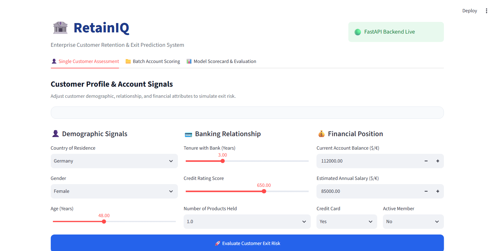
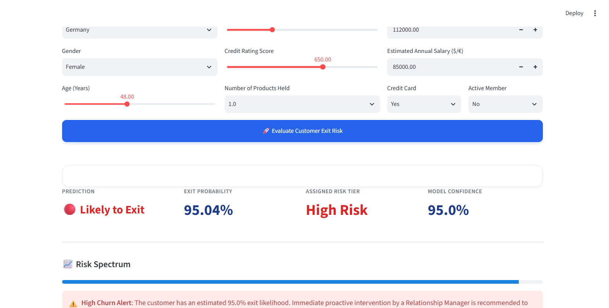
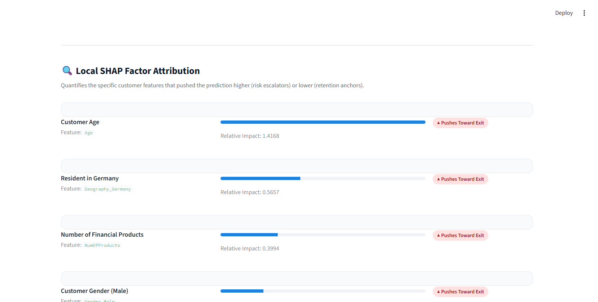
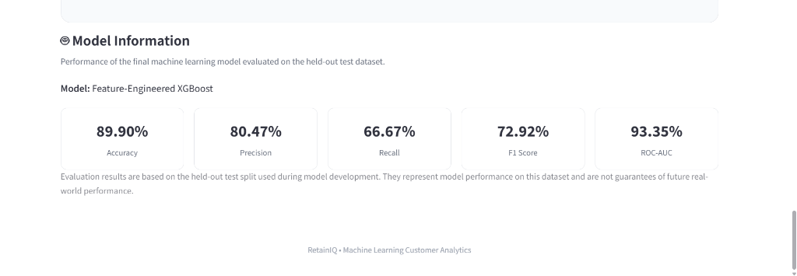

# RetainIQ: Customer Retention & Exit Prediction System

[](https://www.python.org/)
[](https://fastapi.tiangolo.com/)
[](https://streamlit.io/)
[](https://xgboost.readthedocs.io/)
[](https://shap.readthedocs.io/)

---

## 📌 1. Project Overview

**RetainIQ** is an end-to-end machine learning system designed for the banking and financial services sector to predict customer churn/exit risk and deliver actionable, explainable insights.

By combining a **Feature-Engineered XGBoost** classifier with **SHAP (SHapley Additive exPlanations)** interpretability, a high-performance **FastAPI** backend, and an interactive **Streamlit** dashboard, RetainIQ empowers relationship managers and retention teams to identify at-risk customers proactively and understand the underlying factors driving each individual risk score.

---

## 🎯 2. Problem Statement

Customer acquisition in retail banking is considerably more expensive than customer retention. When savings account holders close their accounts or move their capital elsewhere, financial institutions lose deposits, cross-selling opportunities, and customer lifetime value (LTV).

Traditional rule-based retention methods or retrospective exit interviews identify churn only after the customer has already decided to leave. Financial institutions require a proactive, automated, and interpretable intelligence platform that can:
1. Predict customer exit likelihood from demographic, financial, and engagement signals.
2. Provide transparent, customer-level explanations for why a risk score was assigned.
3. Expose predictions via robust APIs and accessible dashboards for non-technical stakeholders.

---

## 🚀 3. Objectives

- **Develop a Predictive Machine Learning Pipeline**: Clean, preprocess, and engineer behavioral and financial features from retail banking data.
- **Evaluate Multiple Classification Architectures**: Benchmark baseline models against tuned ensemble methods to maximize discriminatory power on imbalanced data.
- **Implement Model Explainability**: Integrate SHAP TreeExplainer to break down predictions into top contributing factors with positive or negative directional impact.
- **Serve Real-Time Predictions**: Expose a RESTful FastAPI service with validation, health checking, and structured explanations.
- **Deliver an Intuitive Interface**: Build a responsive Streamlit application allowing branch staff and analysts to simulate customer profiles and visualize risk metrics instantly.

---

## ✨ 4. Key Features

- **High-Performance Predictive Engine**: Final XGBoost model trained on domain-specific engineered features achieving a **93.35% ROC-AUC** and **89.90% Accuracy** on held-out test data.
- **Individualized SHAP Explanations**: Every prediction includes the top 6 contributing factors explaining *why* the model assigned that exit probability.
- **RESTful API Service**: Built on FastAPI with strict Pydantic schemas, auto-generated OpenAPI/Swagger documentation, and sub-100ms inference latency.
- **Interactive Decision Dashboard**: Streamlit web app with dynamic risk categorizations (Low, Moderate, High), customer profile snapshots, and feature importance gauges.
- **Modular Codebase**: Clean separation between data preprocessing, model persistence, API serving, and user interface.

---

## 📸 5. Application Screenshots & Demo

The RetainIQ analytical interface provides a complete decision-support workflow for banking relationship teams:

### 1. Main Dashboard & Customer Profile Input

*Interactive customer profile and account information forms allowing analysts to simulate customer demographics, credit attributes, tenure, and relationship characteristics.*

### 2. Prediction Result & Risk Assessment

*Real-time risk scoring displaying calibrated exit probability (e.g., 95.84%), categorical status (`Likely to Exit`), risk tier (`High`), and essential customer profile snapshots.*

### 3. SHAP Explainability & Feature Contribution

*Local SHAP feature attributions ranking the top individual drivers (such as product count, age, geography, and member engagement) that increase or decrease churn likelihood for the evaluated customer.*

### 4. Model Performance & Benchmarks

*In-dashboard model scorecard highlighting verified performance metrics on the held-out test dataset (89.90% Accuracy, 80.47% Precision, 66.67% Recall, 72.92% F1, and 93.35% ROC-AUC).*

---

## 🛠️ 6. Technology Stack

| Layer | Technology | Purpose |
| :--- | :--- | :--- |
| **Language** | Python 3.10+ | Core language for analysis, training, and serving |
| **Data Processing & Math** | Pandas, NumPy | Data wrangling, tabular manipulation, and vectorized operations |
| **Machine Learning** | Scikit-learn, XGBoost | Preprocessing, model evaluation, and gradient-boosted decision trees |
| **Explainability** | SHAP | Shapley additive feature importance and model interpretability |
| **Serialization** | Joblib | Model weights and feature order persistence |
| **Visualization** | Matplotlib, Seaborn | Exploratory data analysis and distributional charting |
| **Backend API** | FastAPI, Uvicorn, Pydantic | Asynchronous REST API, web server, and strict schema validation |
| **Frontend UI** | Streamlit, Requests | Interactive analyst dashboard and API client integration |

---

## 🏗️ 7. Project Architecture

```
                  +-----------------------------------+
                  |         Retail Banking Data       |
                  |     data/raw/bank_churn_raw.csv   |
                  +-----------------+-----------------+
                                    |
                                    v
                  +-----------------+-----------------+
                  |      Exploratory Data Analysis    |
                  |        & Feature Engineering      |
                  +-----------------+-----------------+
                                    |
                                    v
                  +-----------------+-----------------+
                  |       Model Training & Tuning     |
                  |     (Feature-Engineered XGBoost)  |
                  +-----------------+-----------------+
                                    |
                    +---------------+---------------+
                    |                               |
                    v                               v
         +----------+----------+         +----------+----------+
         |   models/xgb_model  |         | feature_names.pkl   |
         +----------+----------+         +----------+----------+
                    |                               |
                    +---------------+---------------+
                                    |
                                    v
                  +-----------------+-----------------+
                  |          FastAPI Service          |
                  |           (api/main.py)           |
                  |  - /predict: XGBoost + SHAP       |
                  |  - /: Health Check                |
                  +-----------------+-----------------+
                                    ^
                                    | HTTP Requests (JSON)
                                    v
                  +-----------------+-----------------+
                  |        Streamlit Web App          |
                  |      (app/streamlit_app.py)       |
                  +-----------------------------------+
```

---

## 📁 8. Project Structure

```text
HCL_Project/
├── .gitignore                   # Version control exclusions (ignores caches, venvs, envs)
├── requirements.txt             # Minimal, pinned dependencies required by the project
├── README.md                    # Comprehensive project documentation
├── config/
│   └── config.yaml              # Centralized hyperparameters, seeds & project paths
├── screenshots/                 # Application screenshots for GitHub README display
│   ├── 01_dashboard_inputs.png  # Customer demographic and account input form
│   ├── 02_prediction_result.png # Risk classification, probability bar & snapshot
│   ├── 03_shap_explainability.png # Local SHAP feature influence breakdown
│   └── 04_model_performance.png # Held-out test performance metric cards
├── data/
│   ├── raw/
│   │   └── bank_churn_raw.csv   # Primary banking dataset (15,000 customer records)
│   ├── processed/               # Processed/split datasets directory
│   └── README.md                # Data dictionary & dataset documentation
├── models/
│   ├── final_model.pkl          # Primary serialized winning classifier
│   ├── xgb_model.pkl            # Backward-compatible serialized model
│   ├── feature_names.pkl        # Ordered list of training feature names for alignment
│   ├── model_metadata.json      # Complete hyperparameter & evaluation metadata
│   └── experiment_log.csv       # Multi-model CV and test benchmark tracking log
├── src/
│   ├── __init__.py              # Core ML module package initialization
│   ├── data_loader.py           # Ingestion, schema validation & train/test splitting
│   ├── feature_engineering.py   # Domain feature transformations & sklearn transformer
│   ├── preprocessing.py         # Leakage-safe ColumnTransformer preprocessing pipeline
│   ├── tuning.py                # Hyperparameter tuning with StratifiedKFold
│   ├── train.py                 # Multi-model training, benchmarking & evaluation pipeline
│   └── utils.py                 # Configuration loader, seed setter & logging utilities
├── tests/
│   └── __init__.py              # Test suite initialization
├── reports/
│   └── figures/                 # Evaluation figures & artifact outputs
├── preprocessing/
│   └── feature_engineering.py   # Domain feature transformation functions
├── api/
│   └── main.py                  # FastAPI application with prediction & SHAP explanation
├── app/
│   └── streamlit_app.py         # Streamlit analytical user interface
└── notebooks/
    └── 01_EDA.ipynb             # Complete EDA, modeling & evaluation notebook
```

---

## 📊 9. Dataset Description

The project utilizes retail banking customer records (`data/raw/bank_churn_raw.csv`) comprising **15,000 customer instances** across **14 attributes**:

| Attribute | Data Type | Description |
| :--- | :--- | :--- |
| `id` | Integer | Internal record identifier |
| `CustomerId` | Integer | Unique identifier for each bank client |
| `Surname` | String | Customer family name (excluded during modeling) |
| `CreditScore` | Integer | Credit bureau rating score (300 to 850) |
| `Geography` | String | Country of residence (`France`, `Germany`, `Spain`) |
| `Gender` | String | Client gender (`Male`, `Female`) |
| `Age` | Float / Int | Customer age in years |
| `Tenure` | Integer | Number of years the customer has banked with the institution |
| `Balance` | Float | Current account balance |
| `NumOfProducts`| Integer | Number of financial products held with the bank (1 to 4) |
| `HasCrCard` | Binary (0/1) | Whether the customer holds an active credit card |
| `IsActiveMember`| Binary (0/1) | Bank activity index indicating recent customer engagement |
| `EstimatedSalary`| Float | Estimated annual earnings |
| **`Exited`** | **Binary (0/1)**| **Target variable**: `1` if customer exited/closed account, `0` if retained |

**Target Distribution**: Approximately **79.6% retained (`0`)** and **20.4% exited (`1`)**, reflecting realistic banking churn class imbalance.

---

## 🧹 10. Data Preprocessing

1. **Identifier Removal**: Non-predictive identification variables (`id`, `CustomerId`, `Surname`) were removed prior to model ingestion.
2. **Missing Value Verification**: The dataset was verified for nulls; no synthetic imputation was required.
3. **Categorical Encoding**:
   - `Geography`: One-hot encoded into binary flags `Geography_Germany` and `Geography_Spain` (with `France` as reference baseline).
   - `Gender`: Encoded into binary indicator `Gender_Male` (`1` = Male, `0` = Female).
4. **Train-Test Stratification**: Partitioned using stratified sampling to maintain the exact class balance between training and evaluation splits.

---

## 🔍 11. Exploratory Data Analysis (EDA)

Key patterns uncovered during data exploration:
- **Age as Primary Driver**: Older customers exhibited substantially higher exit rates. The likelihood of closure rises significantly between ages 45 and 65.
- **Product Portfolio Non-Linearity**: Customers with 2 products demonstrated the highest retention. Conversely, customers with 3 or 4 products showed elevated churn rates.
- **Customer Activity**: Active members (`IsActiveMember == 1`) were retained at nearly double the rate of inactive members.
- **Geographic Disparities**: Customers in Germany showed a notably higher churn propensity compared to clients in France and Spain.
- **Zero-Balance Phenomena**: A significant sub-population possessed zero account balance, requiring distinct indicator handling from positive balance distributions.

---

## ⚙️ 12. Feature Engineering

To capture non-linear dynamics and interaction effects, 6 domain features were engineered in `preprocessing/feature_engineering.py`:

```python
def engineer_features(df):
    df = df.copy()
    
    # 1. Zero-balance behavioral flag
    df["IsZeroBalance"] = (df["Balance"] == 0).astype(int)
    
    # 2. Financial depth per relationship product
    df["BalancePerProduct"] = df["Balance"] / df["NumOfProducts"]
    
    # 3. Non-linear polynomial age penalty
    df["AgeSquared"] = df["Age"] ** 2
    
    # 4. Product engagement interaction
    df["ActiveProductInteraction"] = df["IsActiveMember"] * df["NumOfProducts"]
    
    # 5. Age and activity interaction
    df["AgeActivityInteraction"] = df["Age"] * df["IsActiveMember"]
    
    return df
```

Combined with one-hot encoded demographics, the final model trains on **16 aligned features** saved in `models/feature_names.pkl`.

---

## 🧪 13. Models Evaluated

The notebook benchmarks multiple classification paradigms:
1. **Logistic Regression**: Linear baseline with standard scaling. Provided foundational benchmark but struggled with non-linear churn boundaries.
2. **Decision Tree Classifier**: Captured local decision splits but exhibited high variance and propensity to overfit.
3. **Random Forest Classifier**: Bagging ensemble improving generalizability and mitigating decision tree variance.
4. **XGBoost (Baseline)**: Gradient-boosted decision trees showing marked gains in discrimination over baseline models.
5. **Feature-Engineered XGBoost (Final)**: Tuned gradient-boosting incorporating engineered interaction terms and polynomial features.

---

## 🏆 14. Final Model & Evaluation Metrics

The **Feature-Engineered XGBoost Classifier** was selected as the final production model. Performance evaluated strictly on the **held-out test split**:

| Metric | Score | Interpretation |
| :--- | :---: | :--- |
| **ROC-AUC** | **93.35%** | Exceptional ranking ability to separate churners from loyal clients |
| **Accuracy** | **89.90%** | High overall classification accuracy on test records |
| **Precision**| **80.47%** | High confidence when flagging a customer as at-risk (low false alarm rate) |
| **Recall** | **66.67%** | Captures two-thirds of all actual account closures |
| **F1-Score** | **72.92%** | Balanced harmonic mean between precision and recall on imbalanced target |

---

## 💡 15. SHAP Explainability

RetainIQ integrates **SHAP (SHapley Additive exPlanations)** using `shap.TreeExplainer`:
- **Local Interpretability**: Quantifies exactly how much each individual feature shifted the baseline log-odds for a given customer.
- **Directional Categorization**:
  - `SHAP > 0`: Feature **increases** exit likelihood (risk escalator).
  - `SHAP < 0`: Feature **decreases** exit likelihood (retention anchor).
- **Top Factor Selection**: The API automatically isolates and sorts the top 6 most impactful attributes for every customer evaluation.

> [!NOTE]
> **Non-Causal Notice**: SHAP values explain how the machine learning model combines mathematical features to arrive at its score. They reflect statistical associations within the trained model and should **not** be interpreted as causal proof in real-world customer behavior.

---

## 🔌 16. FastAPI Service & Health Check

The backend is implemented with **FastAPI** (`api/main.py`), offering real-time prediction and interactive API documentation at `http://127.0.0.1:8000/docs`.

### Endpoints

#### 1. API Health Check
- **Route**: `GET /`
- **Purpose**: Verify that the API server is live and responsive.
- **Response**:
  ```json
  {
    "message": "RetainIQ API is running"
  }
  ```

#### 2. Customer Exit Prediction & Explanation
- **Route**: `POST /predict`
- **Purpose**: Receive customer JSON data, execute feature engineering, run XGBoost inference, compute SHAP feature contributions, and return structured risk results.

---

## 💻 17. Streamlit Application

The frontend dashboard (`app/streamlit_app.py`) provides an interactive interface for bank staff:
- **Demographic Inputs**: Credit score, age, country, gender, tenure, product count.
- **Financial Inputs**: Balance, salary, credit card ownership, active membership.
- **Real-Time Visualizations**:
  - Exit probability progress meter.
  - Risk categorization banner (**Likely to Stay** vs **Likely to Exit**).
  - Risk level badge (**Low**, **Moderate**, **High**).
  - Customer snapshot key performance metrics.
  - Top SHAP contributing factors with intuitive impact badges.
  - Model information and held-out test evaluation benchmarks.

---

## 🚀 18. How to Run Locally

### Prerequisites
- Python 3.10, 3.11, or 3.12 installed.
- Git (optional, for version control).

### Step 1: Clone or Navigate to Directory
```bash
cd c:\Users\siddi\HCL_Project
```

### Step 2: Set Up Virtual Environment
```bash
# Create virtual environment
python -m venv .venv

# Activate on Windows (PowerShell)
.\.venv\Scripts\Activate.ps1

# Activate on Windows (Command Prompt)
.\.venv\Scripts\activate.bat

# Activate on macOS/Linux
source .venv/bin/activate
```

### Step 3: Install Required Dependencies
```bash
pip install -r requirements.txt
```

### Step 4: Launch FastAPI Backend
Open a terminal and start the Uvicorn server:
```bash
uvicorn api.main:app --reload --host 127.0.0.1 --port 8000
```
*The API is now live at `http://127.0.0.1:8000` (Swagger UI at `/docs`).*

### Step 5: Launch Streamlit Frontend
Open a separate terminal, ensure `.venv` is active, and launch Streamlit:
```bash
streamlit run app/streamlit_app.py
```
*The web application will open automatically in your browser at `http://localhost:8501`.*

---

## 📬 19. Example API Request & Response

### Example Request (`POST /predict`)
```json
{
  "CreditScore": 650,
  "Geography": "Germany",
  "Gender": "Female",
  "Age": 48.0,
  "Tenure": 3,
  "Balance": 112000.0,
  "NumOfProducts": 1,
  "HasCrCard": 1,
  "IsActiveMember": 0,
  "EstimatedSalary": 85000.0
}
```

### Example Response (`HTTP 200 OK`)
```json
{
  "prediction": 1,
  "exit_probability": 0.8142,
  "status": "Likely to Exit",
  "explanation": [
    {
      "feature": "Age",
      "shap_value": 0.8942,
      "impact": "Increases exit likelihood"
    },
    {
      "feature": "Geography_Germany",
      "shap_value": 0.5211,
      "impact": "Increases exit likelihood"
    },
    {
      "feature": "IsActiveMember",
      "shap_value": 0.4318,
      "impact": "Increases exit likelihood"
    },
    {
      "feature": "NumOfProducts",
      "shap_value": 0.3891,
      "impact": "Increases exit likelihood"
    },
    {
      "feature": "BalancePerProduct",
      "shap_value": 0.1845,
      "impact": "Increases exit likelihood"
    },
    {
      "feature": "CreditScore",
      "shap_value": -0.0421,
      "impact": "Decreases exit likelihood"
    }
  ]
}
```

---

## ⚠️ 20. Disclaimers & Assumptions

- **Target Definition**: The target variable `Exited` indicates whether a savings account was closed or the customer discontinued their relationship.
- **Statistical Model Outputs**: Model predictions represent estimated likelihoods computed from historical patterns, not guaranteed future outcomes.
- **Evaluation Validity**: All reported evaluation metrics (ROC-AUC, Precision, Recall, F1) were measured against a held-out test split established during development.
- **SHAP Interpretation**: SHAP explanations describe feature importance internal to the mathematical model; they do not establish business causation.

---

## ⚠️ 21. Limitations

- **Geographic Representation**: The training data is sampled from customers residing in France, Germany, and Spain. Generalization to other banking jurisdictions may require domain retraining.
- **Feature Set Scope**: The model is based on static demographic and aggregated account balances. Real-time transaction sequences or customer service sentiment are not captured in the current feature set.
- **Concept Drift**: Shifts in macroeconomic conditions (e.g., central bank interest rates, local competitor campaigns) can alter customer exit propensities over time.

---

## 🔮 22. Future Enhancements

- **Relational Storage**: Connect PostgreSQL database for persistent logging of predictions and audit history.
- **Containerization & CI/CD**: Package API and UI into lightweight Docker containers with GitHub Actions deployment workflows.
- **MLOps Tracking**: Implement MLflow for model registry, experiment tracking, and automated drift detection.
- **NLP Feedback Analysis**: Incorporate customer service chat transcripts and survey feedback with transformer-based sentiment models.
- **Security & RBAC**: Add OAuth2/JWT authentication and role-based access controls for branch vs. managerial users.

---

## 👤 23. Author

**RetainIQ Development Team**  
*Enterprise Customer Analytics & Machine Learning Project*
