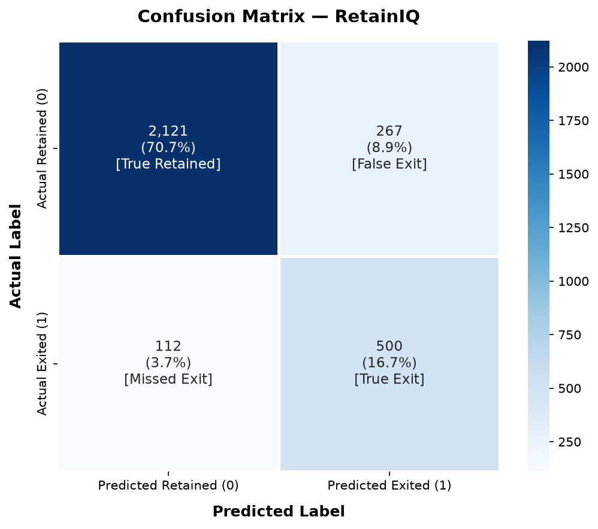
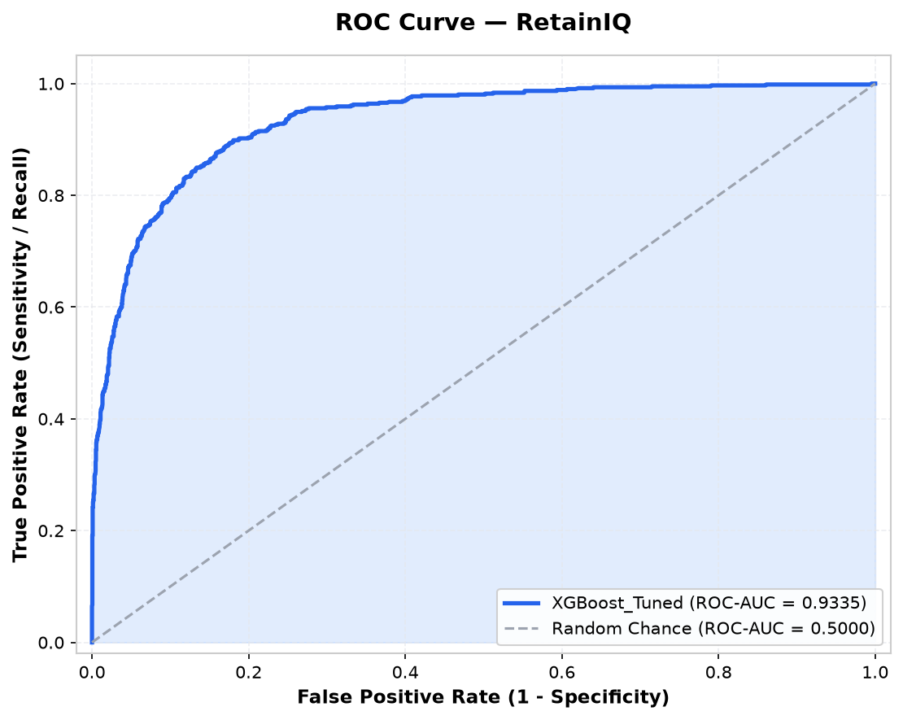
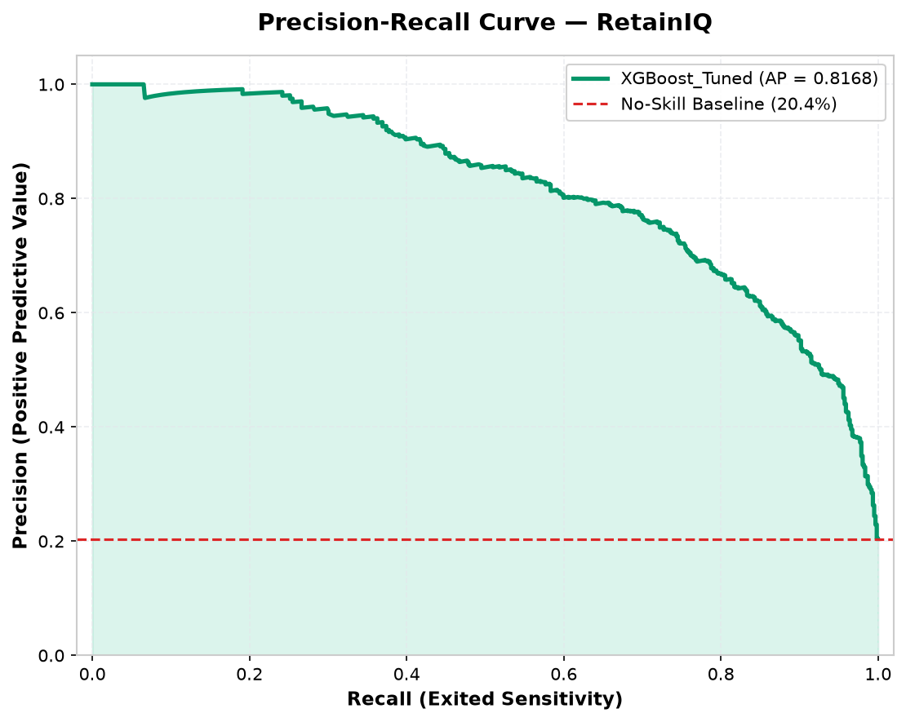
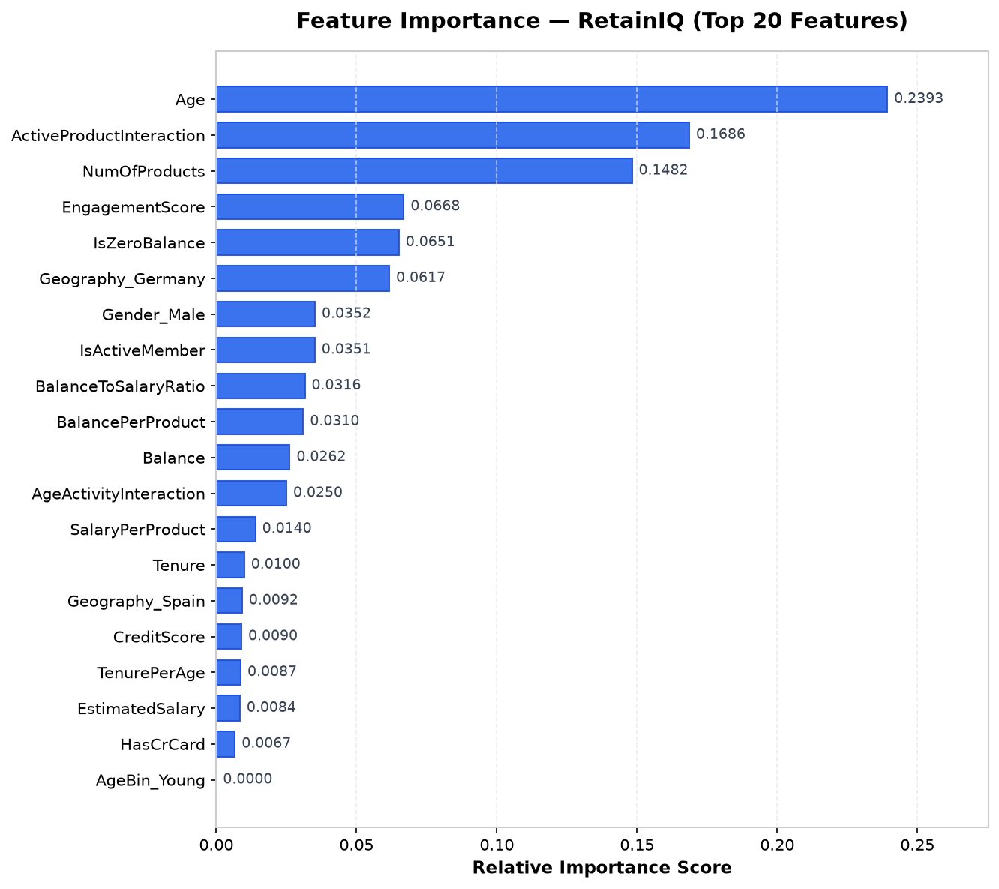
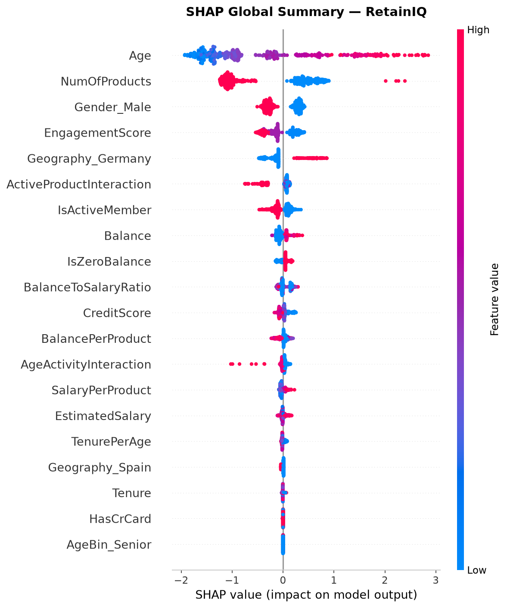
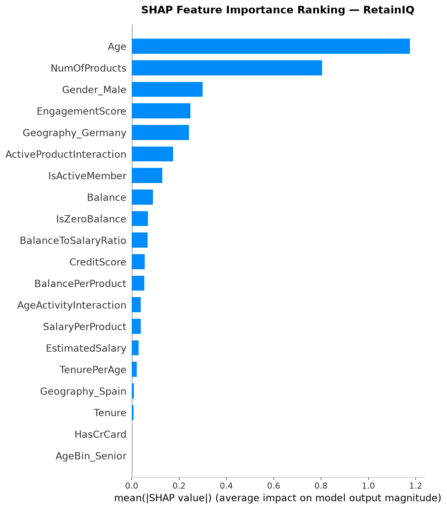
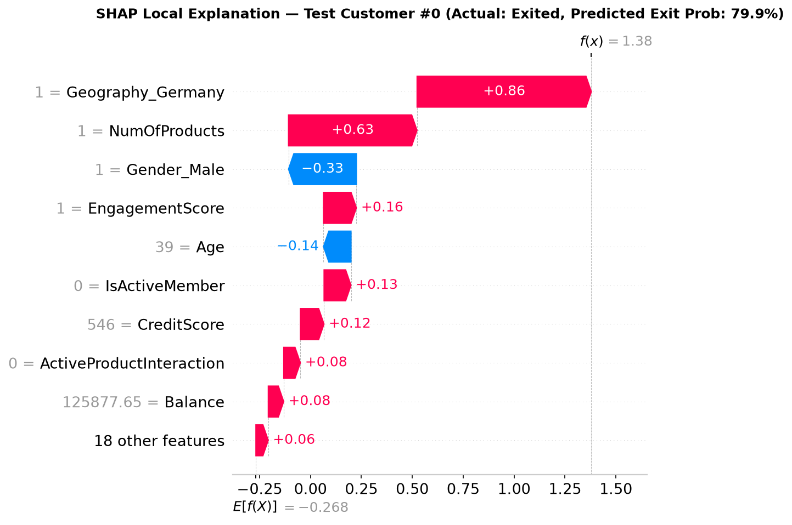
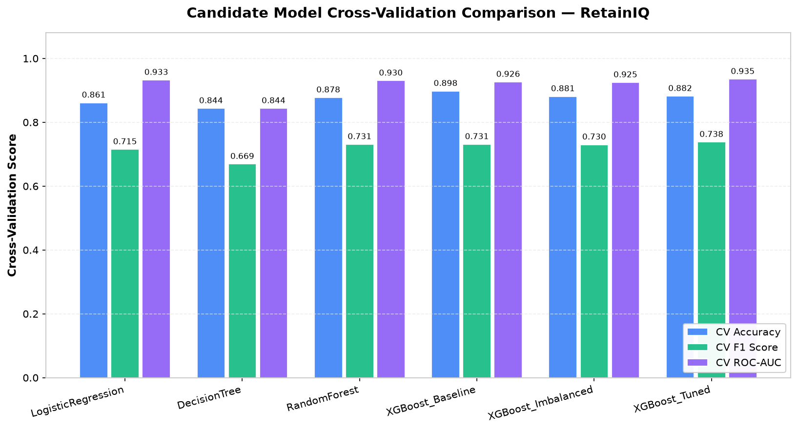

# RetainIQ — Model Evaluation Report

## 1. Final Model

- Model: XGBoost_Tuned
- Training timestamp: 2026-10-31T01:05:53.300340
- Number of features: 27
- Number of test samples: 3,000

## 2. Test Set Performance

| Metric | Score |
|---|---:|
| Accuracy | 0.8737 |
| Precision | 0.6519 |
| Recall | 0.8170 |
| F1 Score | 0.7252 |
| ROC-AUC | 0.9335 |

## 3. Classification Report

```text
              precision    recall  f1-score   support

Retained (0)     0.9498    0.8882    0.9180      2388
  Exited (1)     0.6519    0.8170    0.7252       612

    accuracy                         0.8737      3000
   macro avg     0.8009    0.8526    0.8216      3000
weighted avg     0.8891    0.8737    0.8786      3000

```

## 4. Confusion Matrix



The model correctly classified **2,121** retained customers (True Negatives) and **500** exiting customers (True Positives) out of 3,000 test records. It recorded **267** False Positives (retained customers flagged as exit risks) and **112** False Negatives (actual exits that were missed).

## 5. ROC Curve



The final model achieved a **Receiver Operating Characteristic Area Under the Curve (ROC-AUC)** of **0.9335**, demonstrating superior discrimination capability over the random baseline (0.5000) across all classification thresholds.

## 6. Precision-Recall Curve



On this class-imbalanced banking dataset (minority exit rate of 20.4%), the model maintained an **Average Precision (AP)** of **0.8168**, significantly outperforming the uninformative baseline rate of 20.4%.

## 7. Feature Importance



Top influential features identified by the model:
1. **Age** (Importance: 0.2393)
2. **ActiveProductInteraction** (Importance: 0.1686)
3. **NumOfProducts** (Importance: 0.1482)
4. **EngagementScore** (Importance: 0.0668)
5. **IsZeroBalance** (Importance: 0.0651)

## 8. SHAP Global Explanation





The SHAP beeswarm and global importance plots reveal directional feature contributions to exit probabilities:
- Higher customer age significantly shifts log-odds toward exit.
- Active membership and multi-product relationship depth strongly suppress exit probability.
- German customers demonstrate higher baseline propensity to churn compared to France or Spain.

### Representative Local Explanation



Customer #0 was identified with an actual status of **Exited** and a model-predicted exit probability of **79.9%**. Key driving factors pushing the prediction higher included elevated customer age and lower product interaction breadth.

## 9. Model Comparison



Across 5-fold stratified cross-validation evaluated during Phase 4, the selected model achieved the highest overall discriminatory performance while maintaining a robust balance between exit recall and precision compared to Logistic Regression, Decision Trees, and Random Forests.

## 10. Key Findings

- The final model achieved an ROC-AUC of **0.9335** and an accuracy of **0.8737** on the held-out test set of 3,000 customer accounts.
- Recall for the exited class reached **0.8170**, successfully capturing **500 of 612** (81.7%) actual exiting bank customers.
- Precision for the exited class reached **0.6519**, meaning nearly two out of every three flagged customers were genuine exit risks.
- The most influential predictive features according to global SHAP values were **Age, NumOfProducts, and Gender_Male**, confirming the primacy of demographic maturity and engagement depth.
- In threshold sensitivity testing, lowering the operational threshold to **0.30** elevates recall to **91.50%** (capturing 560/612 exiters) for high-value proactive retention outreach.

## 11. Interpretation

In retail banking customer retention, the business asymmetry between False Negatives and False Positives is critical:
- A **False Negative** (failing to identify an exiting customer) leads to irrevocable attrition, loss of depository balances, and high acquisition costs for replacement customers.
- A **False Positive** (reaching out to a satisfied customer with a retention incentive or courtesy check-in) incurs minor communication or discount costs and frequently improves customer goodwill.

The model's strong recall (81.7%) directly serves the bank's core operational priority by systematically surfacing four out of every five accounts at risk of closure, enabling targeted relationship manager interventions before balance liquidation occurs.

## 12. Limitations

- **Dataset Scope & Time Horizon**: The current dataset represents a historical snapshot of retail accounts without continuous transaction time-series or seasonal macroeconomic indicators (e.g., interest rate shifts).
- **Class Imbalance**: Customers exiting constitute approximately 20.4% of total accounts. While addressed via scale-pos-weight and stratified sampling, boundary calibration remains sensitive.
- **Model Assumptions**: Tree-based gradient boosting models capture complex non-linear interactions effectively, but can be prone to localized overfitting if customer demographic patterns drift significantly.
- **Generalization Across Geographies**: Features like `Geography_Germany` reflect substantial localized behavioral variance; applying this model directly to other countries or customer segments would require domain recalibration.
- **Threshold Operational Trade-offs**: Operating at the default 0.50 threshold yields balanced F1 (0.7252), but enterprise deployments should dynamically tune thresholds (0.30–0.60) according to campaign budgets and intervention capacities.
